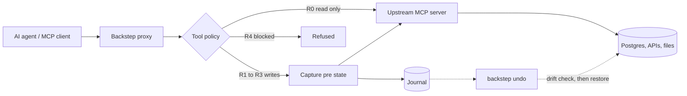

# Backstep

**An undo button for AI agents.**

Backstep sits between an AI agent and the tools it calls. Before the agent changes any data, Backstep records what that data looked like. If the agent makes a mistake, you can review exactly what it did and roll it back with one command.

AI agents are getting real write access to production systems like databases, file stores, and cloud accounts. They are also still prone to mistakes, like an UPDATE with the wrong WHERE clause or a loop that inserts the same row two hundred times. Most teams handle this risk by either keeping agents read only or hoping for the best. Backstep offers a third option. Let the agent act, keep a precise record of every change, and make recovery fast and safe.


## Highlights

- **Transparent MCP proxy.** Works with any client that speaks the Model Context Protocol, such as Claude Desktop, Claude Code, or Cursor. The agent sees the same tools it always did. No changes to the agent or the upstream server are needed.
- **Pre change state capture.** For SQL tools, Backstep parses each statement with sqlglot, works out which rows it will touch, and snapshots them before the statement runs.
- **Safe, conservative rollback.** Before undoing anything, Backstep checks whether the data has changed since the agent touched it. If someone else edited the same rows, it refuses to revert rather than overwrite their work.
- **Reversibility policy per tool.** Every tool is tagged on a scale from R0 (read only) to R4 (irreversible). Irreversible tools can be blocked outright, and risky ones can require human confirmation.
- **LLM assisted setup, deterministic runtime.** `backstep init` uses Claude to propose a reversibility class for every tool an upstream server exposes. A human reviews the proposals, and at runtime the policy is enforced with no model in the loop.
- **Measured, not just tested.** A recovery benchmark runs realistic "agent gone wrong" scenarios against a real Postgres database and grades how well Backstep actually recovered.

## How it works



1. **Intercept.** The proxy aggregates tools from every configured upstream MCP server and routes each call through an interceptor.
2. **Classify.** The interceptor looks up the tool's reversibility class and decides whether to pass it through, journal it, ask for confirmation, or block it.
3. **Capture.** For write operations, an adapter snapshots the affected state. The Postgres adapter opens its own connection, rewrites the agent's INSERT, UPDATE, or DELETE into a SELECT over the same rows, and stores the result.
4. **Journal.** Each action is written to an append only SQLite journal with its arguments, the state before the change, and a fingerprint of the state right after it.
5. **Revert.** When you undo an action, the reverter compares the live rows against that fingerprint. If nothing has drifted, it restores the original rows. If anything has, it stops and shows you the difference.

The interceptor never alters or swallows the upstream response. If journaling itself fails, the failure is logged and the agent's call still goes through, so Backstep cannot break a working agent.

## Reversibility classes

| Class | Meaning | Default handling |
|---|---|---|
| R0 | Read only, no state change | Passed through |
| R1 | Fully reversible, prior state can be restored exactly | Captured and journaled |
| R2 | Reversible with some loss, such as a delete that loses identity metadata | Captured, optional confirmation |
| R3 | Compensable only, needs a semantic inverse rather than a restore | Journaled without a snapshot |
| R4 | Irreversible | Refused unless explicitly allowed, or blocked outright |

## Recovery benchmark

Passing unit tests proves the code is correct. It does not prove that Backstep saves you when an agent does something wrong. `backstep eval` runs a scripted set of failure scenarios end to end through the real proxy, journal, and Postgres adapter against a throwaway database, then grades each recovery.

| Scenario | What the agent did | Result | Time to recover |
|---|---|---|---|
| wrong_where_update | UPDATE that matched far more rows than intended | Full recovery | 28 ms |
| runaway_insert_loop | 200 INSERTs from a stuck loop | Full recovery | 2.7 s |
| mixed_session | 3 updates, 1 delete, and 1 insert undone together | Full recovery | 87 ms |
| cascading_delete | DELETE on a parent table with ON DELETE CASCADE children | Partial recovery | 37 ms |
| partial_drift | Another process edited a row after the agent did | Correctly refused | 3 ms |
| unparseable_sql | A CTE heavy statement that cannot be safely captured | Correctly refused | 17 ms |

**3 full recoveries, 1 partial, and 2 correct refusals out of 6 scenarios.**

Two of these results are worth calling out. In `partial_drift` and `unparseable_sql`, refusing is the passing outcome, because reverting would have destroyed someone else's data or guessed at a statement Backstep could not understand. The `cascading_delete` result is reported honestly as partial. Postgres removes child rows inside the same statement, before Backstep can see them individually, which is a real limit of statement level capture.

Full results live in [`eval_results.json`](eval_results.json).

## Engineering approach

A tool whose job is safety has to be trustworthy itself, so the codebase is built around a few rules.

- **Refuse instead of guess.** Any ambiguity, such as missing pre state, no primary key, drift, or an action that was already reverted, ends in a refusal with a clear reason. There are ten distinct revert outcomes, and only one of them modifies data.
- **Mutation guard tests.** `tests/test_mutation_guards.py` switches off one safety mechanism at a time and asserts that the matching scenario now fails. This proves each guard is actually doing the work, rather than the test passing by accident.
- **Lossless serialization.** A custom codec round trips Postgres types like Decimal, UUID, timestamps, bytes, and ranges exactly, so fingerprints stay stable and restored rows match the originals byte for byte.
- **Append only journal.** Once an action is recorded, the fields describing what happened are never rewritten. Only status fields change.
- **Real database tests.** Postgres tests run against a disposable container via testcontainers, with a fresh schema per test. Over 110 tests, fully typed with mypy, and linted with ruff.

## Tech stack

Python 3.11+, asyncio, the MCP Python SDK, asyncpg, sqlglot, SQLite (aiosqlite), Pydantic, Typer, Rich, the Anthropic API, pytest, and testcontainers. Managed with uv.

## Getting started

Install dependencies with [uv](https://docs.astral.sh/uv/).

```sh
uv sync
```

Copy the example config and fill in your upstream server command and Postgres connection string.

```sh
cp backstep.example.toml backstep.toml
```

Optionally, let Claude propose a reversibility class for every tool your upstream servers expose. This requires `ANTHROPIC_API_KEY` to be set, and every proposal is written to `backstep.toml` for you to review.

```sh
uv run backstep init
```

Check that the config, journal, and database are all reachable.

```sh
uv run backstep doctor
```

Then point your MCP client at the proxy instead of the upstream server.

```sh
uv run backstep serve
```

## Command reference

| Command | Purpose |
|---|---|
| `backstep serve` | Run the proxy between your MCP client and upstream servers |
| `backstep init` | Discover upstream tools and propose reversibility classes with an LLM |
| `backstep doctor` | Verify config, journal, and adapter connectivity |
| `backstep sessions` | List recent agent sessions |
| `backstep log <session>` | Show every action in a session |
| `backstep show <action>` | Inspect one action, including any drift since it ran |
| `backstep undo <action>` | Revert a single action |
| `backstep undo-session <session>` | Revert a whole session in reverse order |
| `backstep eval` | Run the recovery benchmark |

## Development

```sh
uv run pytest
uv run pytest -m mutation
uv run ruff check .
uv run mypy src
```

Tests that need Postgres start a throwaway Docker container automatically. If Docker is not available, those tests are skipped rather than failed. To use a Postgres you already have running instead, set the `BACKSTEP_TEST_PG_DSN` environment variable to its connection string. Each test still gets its own disposable schema, so nothing leaks between runs. `backstep doctor` reports which mode is active.

## Project layout

```
src/backstep/
  proxy.py           MCP proxy and tool call interceptor
  registry.py        Per tool reversibility policy lookup
  journal.py         Append only SQLite journal of actions and pre state
  reverter.py        Drift checking and revert orchestration
  adapters/
    base.py          Adapter interface and state fingerprinting
    postgres.py      SQL parsing, row capture, and restore for Postgres
  bootstrap.py       LLM assisted tool classification for backstep init
  codec.py           Lossless JSON codec for database native types
  eval.py            Recovery benchmark runner
  doctor.py          Environment and config diagnostics
  cli.py             Typer command line interface
tests/
  scenarios/         Agent failure scenarios used by backstep eval
```

## License

MIT. See [LICENSE](LICENSE).
